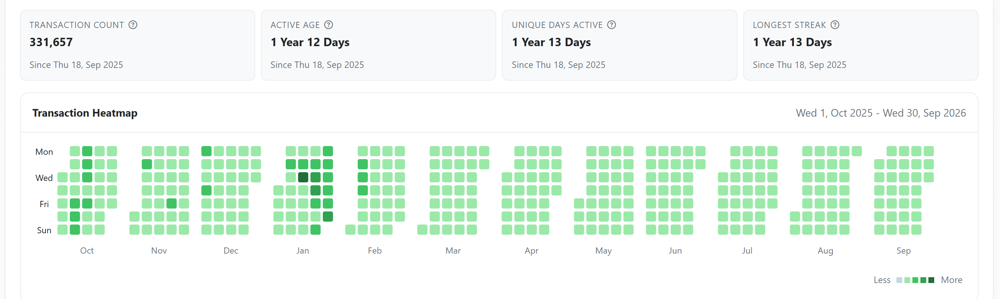

**Senior Backend Engineer | Go · Distributed Systems · EVM/RPC Infrastructure**

I've spent 6+ years building distributed systems across fintech, telecom, and Web3, including Kafka-backed services processing **20M+ events/day**. I also independently built and operated a low-latency Go trading system on Base (an Ethereum Layer 2) that identified price differences between decentralized exchanges and executed trades.

## Low-Latency Trading Infrastructure on Base

*Independent production system · 2025–2026*

The Go backend monitored Base Flashblocks, fetched pool state in batches, and evaluated trade routes locally before signing and submitting transactions. Custom Solidity contracts executed trades atomically, supporting 10+ decentralized exchanges.

- Operated in production for **365+ consecutive days**, handling **300k+ transaction submissions**.
- Achieved **sub-100ms p95 end-to-end latency** (Flashblock received → first transaction hash returned).
- Executed **200k+ successful on-chain transactions**, totaling **~$200M in swap volume**.

*BaseScan Analytics · September 30, 2026*

## Distributed Systems in Production

- Built Kafka-backed services processing **20M+ telecom events/day**, using batching and PostgreSQL transactions to atomically persist offsets, business state, and outbox events for replay-safe processing.
- Built long-running financial workflows with Temporal, using idempotent payouts and compensating actions to handle failures.
- Created a shared distributed tracing library adopted across **10+ services**.

**Tech stack:** Go · Java · REST/gRPC · Kafka · Temporal · PostgreSQL · Redis · AWS/GCP · Kubernetes · Terraform · go-ethereum · Solidity
